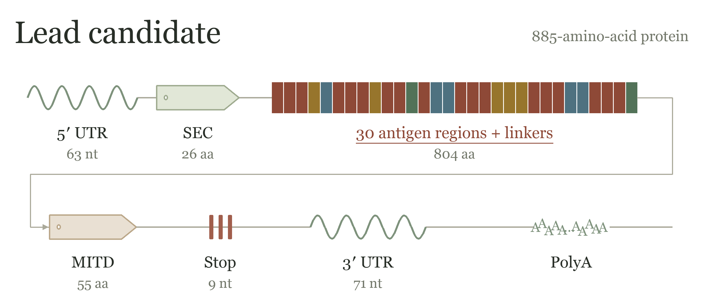

# Design #3 — lead design

**30 antigen regions in an 885-amino-acid protein:** 18 mutation-derived,
five splice-derived, five CTA/self and two CDH1::NRG1 fusion regions.
This directory contains the selection, assembled protein, RNA encoding and
reproduction code. This is the lead candidate shown on the [main website](https://rnafoundry.com/yash/#vaccine).

[Selected antigens](selection/selected.tsv) · [Protein](construct/protein/cassette.fasta) ·
[Known RNA segment](construct/mrna/mrna-segments.fasta) ·
[GenBank](construct/mrna/template-segments.gb) · [Methods](methods.md) ·
[Explore on the main site](https://rnafoundry.com/yash/#vaccine)



## How it was made

1. **Mutation regions.** Thirteen regions have paired tumour–normal DNA evidence
   and Isovar RNA reconstruction, including H2BC12 E114K. Five further regions
   model Guardant-reported AR, DHX36, ERBB4, KMT2D and RAF1 substitutions using
   reference protein contexts; their complete sequences are not RNA-reconstructed.
2. **RNA-derived regions.** Select one window per gene from F5, HLA-B, HSF1,
   NBPF14 and KMT2D. Each 25-aa observed window matches reference bases translated
   across the proposed join. Normal-coordinate ND, recorded read/frame/strand
   rules and broad exact-self exclusion precede affinity/expression ranking.
3. **CTA/self and fusion regions.** Retain five expressed reference-protein
   hypotheses and two distinct CDH1::NRG1 sequence hypotheses. CTA regions are
   intentionally self-derived. The in-frame fusion has an explicit ~509-nM
   affinity exception.
4. **Assembly.** Jointly optimize order and eleven linker choices using fresh
   MHCflurry HLA-I predictions, including SEC and MITD junctions. Apply the
   hydropathy screen and independently predict the selected junctions again.
5. **RNA encoding.** PopRNA synonymously encodes the fixed protein with the
   recorded human codon settings and seed. Preserve the UTRs and three stops;
   PolyA and downstream extension remain unspecified.

Class-I presentation, mutant/reference affinity ratios and CapHLA class-II
predictions are [annotations](review/annotations.md), not new selection or
assembly objectives. The [detailed methods](methods.md) explain the measurements,
exceptions and relevant community contributions.

## Additional DNA candidate in the current plan

H2BC12 E114K comes from the existing paired-DNA and Isovar results, highlighted
in [Issue #1](https://github.com/popvax/yash/issues/1). It has 0/54 alternate
normal fragments, 11/57 alternate RNA fragments and eight longer-context names.
Its supplied expression stays missing; inclusion is explicit, without imputation.
[Reference check](inputs/h2bc12/result.json). FES remains excluded because only
15 aa are RNA-reconstructed.

## RNA candidate pipeline changes

The splice selection requires full-window reference-join identity in addition
to the original evidence rules and expanded normal-protein exclusion. It
therefore does not depend on additional amino-acid substitutions for novelty.
[Selection rules](methods.md#current-rna-selection-rules) ·
[Selected five regions](../../data/shared-rna/splicing/junction-only/selected.tsv).

## Explore the files

| What | Files |
|---|---|
| Antigens | [Selection](selection/selected.tsv) · [FASTA](selection/selected.fasta) |
| Protein | [Sequence](construct/protein/cassette.fasta) · [Order](construct/protein/antigen-order.tsv) · [Components](construct/protein/components.tsv) |
| RNA and DNA | [Coding DNA](construct/mrna/cds.fasta) · [Known RNA](construct/mrna/mrna-segments.fasta) · [Known DNA template](construct/mrna/template-segments.fasta) · [GenBank](construct/mrna/template-segments.gb) |
| Inputs | [Input guide](inputs/README.md) · [Guardant evidence](inputs/guardant/summary.tsv) · [Policy](policy.json) |
| Annotations | [Class I](review/candidate-annotations/README.md) · [Class II](review/class-II-annotations/README.md) · [Combined table](review/class-II-annotations/current-plan.tsv) |
| Checks | [Junctions](construct/final-check.json) · [Encoding/annotations](construct/mrna/verification.json) · [Offline replay](execution/offline-replay.json) |

All four assembly objectives were proven optimal. The independent run checked
7,620 junction peptide/HLA occurrences: zero at percentile ≤0.5, 42 at ≤2 and
35 with affinity ≤500 nM. Optimality does not mean no predicted junction binders.
No unexpected high-hydropathy windows remain.

The known RNA segment is 2,798 nt before unspecified PolyA. Exact translation
and all 76 GenBank features pass checks. The final folding heuristic is 32 paired
bracket symbols, above its 14-nt target; it is reported separately from the hard
translation/codon/motif checks. These computations do not establish presentation
or a T-cell response.

## Run

From the repository root, with the documented Python 3.11/3.12 dependencies:

```sh
yash-vaccine verify
yash-vaccine reproduce --output work/design-3-replay

# Additional entry points
python designs/design-3/selection.py --verify
python designs/design-3/run.py
python designs/design-3/run.py --replay --output work/design-3-replay
```

The `run.py` command without flags prints a plan. Offline replay starts no cloud jobs and
reproduces selection, protein and known nucleotide/GenBank products from the
included evidence. [Execution details](execution/README.md) distinguish verified
local bytes from the large all-option prediction table retained on Modal.

The schematic is drawn from the recorded component tables with `python tools/render_construct.py` (Pillow; an optional `--font` selects a serif font).
